# Awesome-Enterprise-Search-Document-Indexing

  

  

  

  

  

  

# 🔍 Top Enterprise Search & Document Indexing

**Curated List of SaaS/Commercial Platforms & Open-Source GitHub Projects**  

*Focused on AI Workplace Search, Hybrid Lexical/Vector Indexing, Permission-Aware Connectors, Multimodal Document Parsing & Self-Hosted Enterprise RAG Engines*  

**Last updated: November 2026**

This repository tracks notable **SaaS/Commercial platforms** and **open-source projects** for **Enterprise Search & Document Indexing**. These tools power permission-aware workplace search across SaaS silos (Slack, Google Drive, SharePoint, Jira, Confluence), hybrid BM25 + semantic vector retrieval, multimodal PDF/OCR document indexing, and enterprise AI assistants for IT teams, search engineers, and knowledge workers.

**Examples** include Amazon Kendra (AWS), Azure AI Search, Google Cloud Search (Google Workspace), Glean, Elastic Enterprise Search, Hebbia, Algolia, Coveo, Lucidworks Fusion, and Sinequa (ChapsVision) (the category leaders).

**🚀 Open-source emphasis**: This section is heavily expanded with every major active project for open-source workplace AI search (`OneBox`, `Onyx / Danswer`, `PipesHub`, `SurfSense`, `Khoj`), hybrid search & vector indexing engines (`OpenSearch`, `Elasticsearch`, `Vespa`, `Meilisearch`, `Typesense`, `Qdrant`, `Milvus`, `Weaviate`), and document ingestion parsers (`Apache Tika`, `Docling`, `Paperless-ngx`) — ideal for organizations seeking sovereign, RBAC-enforced enterprise search without per-seat SaaS lock-in.

🤝 Contributions welcome! Open a PR to add/update entries. Keep descriptions factual and link to official sites.

## 📑 Table of Contents

- [📊 Sector Overview & Market Dynamics](#-sector-overview--market-dynamics)

- [☁️ SaaS/Hosted & Commercial Platforms](#️-saashosted--commercial-platforms)

- [💻 Open-Source GitHub Projects](#-open-source-github-projects)

- [🛠️ How to Contribute](#️-how-to-contribute)

- [⚠️ Disclaimer](#️-disclaimer)

- [💖 Support & Thank You](#-support--thank-you)

## 📊 Sector Overview & Market Dynamics

The global Enterprise Search & AI Knowledge Discovery market is valued at approximately **$8.5B–$11.2B+ in 2026**, expanding at a ~16%–22% CAGR as organizations replace keyword intranets with permission-aware AI workplace search and Retrieval-Augmented Generation (RAG). The cloud infrastructure and workplace AI search layer exhibits **strong winner-take-most consolidation** around hyperscalers (AWS, Microsoft Azure, Google) and breakout AI search leaders (Glean, Elastic, Hebbia), while the self-hosted engine and workplace-search layer is **thriving with open-source alternatives** (`Onyx`, `OneBox`, `OpenSearch`, `Vespa`, `Meilisearch`, `Typesense`).

## ☁️ SaaS/Hosted & Commercial Platforms

*Sorted descending by company valuation / annual revenue scale.*

| Platform | Description | Company Scale (Valuation / Revenue) | Starting Paid Tier | Free Tier / Trial Limit |

| :--- | :--- | :--- | :--- | :--- |

| **[Amazon Kendra](https://amazon.com)** | Managed AWS intelligent enterprise search service powered by deep learning, native S3/SharePoint/Confluence connectors, and ACL filtering. | **Part of Amazon / AWS** (~$115B+ AWS annual revenue; ~$2T+ parent market cap) | **~$1.125 / hour** (~$810/mo) for Kendra Enterprise Edition base capacity (100k docs) | **30-Day Free Trial** (**750 hours** of Kendra Developer Edition free for the first 30 days on AWS) |

| **[Azure AI Search](https://microsoft.com)** | Microsoft's cloud search-as-a-service platform combining hybrid BM25 + vector indexing, semantic ranker, and AI document cracking pipelines. | **Part of Microsoft Azure** (~$85B+ Azure cloud revenue; ~$3T+ parent market cap) | **~$73.73 / month** ($0.101/hr) for Basic tier (up to 15 indexes, 2 GB storage) | **Forever Free Tier** (**50 MB storage**, up to 3 indexes, and 3 indexers free forever on Azure; 30-day $200 Azure credit) |

| **[Google Cloud Search (Google Workspace)](https://google.com)** | Enterprise workplace search engine indexing Gmail, Drive, Docs, Calendar, and third-party repositories with Google-grade relevance and ACLs. | **Part of Alphabet Inc.** (~$350B+ Alphabet revenue; ~$2T+ market cap) | **$14.00 / user / month** billed annually (Bundled in Google Workspace Business Plus & Enterprise) | **14-Day Free Trial** (Included in 14-day Google Workspace Business Plus/Enterprise evaluation; no standalone free tier) |

| **[Glean](https://glean.com)** | AI-powered enterprise work assistant and unified workplace search connecting 100+ SaaS apps with real-time permission enforcement and RAG agents. | **$4.6B–$7.2B+ Valuation** ($100M+ ARR) | **~$50 / user / month** indicative enterprise seat pricing (minimum ~100-seat annual contracts) | **Guided Enterprise Demo / Pilot** (No public self-serve free tier; custom proof-of-concept workspace via sales) |

| **[Elastic Enterprise Search](https://elastic.co)** | Unified search and AI retrieval platform built on Elasticsearch featuring hybrid vector/lexical search, web crawlers, and Workplace Search connectors. | **~$1.45B+ Annual Revenue** (~$10B+ public market cap) | **$95 / month** for Elastic Cloud Standard (hosted Elasticsearch + vector/hybrid search) | **14-Day Free Trial** (Full Elastic Cloud trial with no credit card; self-hosted Elasticsearch AGPL/Elastic License is free) |

| **[Hebbia](https://hebbia.com)** | AI-native deep document indexing and Matrix analysis platform built for finance, legal, and enterprise teams querying millions of complex pages. | **~$700M+ Valuation** ($130M Series B led by a16z; ~$20M+ est. ARR) | **Enterprise Seat & Compute Contract** (~$50,000+ / year indicative institutional minimum) | **Guided Enterprise Demo** (No public self-serve free tier; tailored enterprise pilot for financial/legal teams) |

| **[Algolia](https://algolia.com)** | Ultra-fast, API-first AI search and discovery platform combining NeuralSearch (vector + keyword), instant typo tolerance, and federated indexing. | **~$2.25B Peak Valuation** (~$150M+ est. ARR) | **$0.50 per 1,000 search requests** (Grow pay-as-you-go plan beyond free quota) | **Forever Free Build Plan** (Up to **10,000 search requests/month** and **100,000 indexed records** free forever) |

| **[Coveo](https://coveo.com)** | Enterprise AI relevance and unified indexing platform powering workplace search, intranet discovery, and customer support RAG pipelines. | **~$135M+ Annual Revenue** (~$600M–$800M public market cap on TSX) | **~$1,500 – $2,500+ / month** indicative starting Pro/Enterprise cloud subscription | **30-Day Guided Trial / Sandbox** (Developer trial sandbox available upon request; no perpetual self-serve free plan) |

| **[Lucidworks Fusion](https://lucidworks.com)** | Enterprise AI-powered search and vector discovery platform built on Apache Solr and neural hybrid search for complex intranets and commerce. | **~$150M–$250M Est. Valuation** (~$50M–$70M est. ARR; $100M+ VC funding) | **Enterprise Annual Subscription** (Custom licensing by document volume & query nodes) | **Guided Enterprise Sandbox / Demo** (No public self-serve free tier; cloud evaluation environment via enterprise sales) |

| **[Sinequa (ChapsVision)](https://sinequa.com)** | Neural enterprise search and RAG platform indexing 200+ complex enterprise repositories with NLP, security ACLs, and multi-language extraction. | **Acquired by ChapsVision** (~$40M+ Sinequa ARR; part of ~$300M+ ChapsVision group) | **Enterprise Annual License** (Custom deployment pricing by indexed document volume and user seats) | **Guided Enterprise Demo / POC** (No public self-serve free tier; custom proof-of-concept evaluation on request) |

## 💻 Open-Source GitHub Projects

| Project | License / Hosting Cost | Free Tier / Self-Hosted Limit | Description |

| :--- | :--- | :--- | :--- |

| **[OneBox (`wangzhishou/OneBox`)](https://github.com)** | **Open-Source** ($0 self-hosted; bring-your-own LLM/embedding endpoints) | **100% Free forever** self-hosted (Unlimited unified document indexing, cross-source search, and AI Q&A on your own servers) | Open-source unified enterprise search and document indexing box designed to aggregate, index, and query fragmented workplace knowledge silos. |

| **[Onyx — formerly Danswer (`onyx-dot-ai/onyx`)](https://github.com)** | **MIT / Enterprise Open-Core** ($0 self-hosted Community Edition; Cloud at $20/user/mo) | **100% Free forever** self-hosted (Unlimited users, 40+ workplace connectors for Slack/Drive/Confluence/Jira, hybrid search, and AI agents) | The leading open-source, self-hosted Glean alternative connecting workplace apps with permission-aware hybrid search and RAG chat. |
